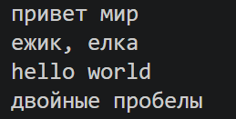
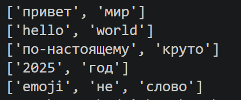
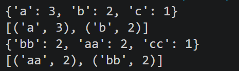
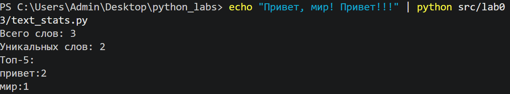

# ЛР3 — Тексты и частоты слов

## Задание A — `src/lib/text.py`

### normalize

Приводит текст к единому виду: нижний регистр (`casefold` или `lower`), замена `ё` на `е`, управляющие символы становятся пробелами, повторяющиеся пробелы схлопываются, края обрезаются.

```python
def normalize(text: str, *, casefold: bool = True, yo2e: bool = True) -> str:
    """Функция приводит текст к единому размеру, превращает ё/Ё в е/Е и убирает лишние пробелы.
    Тесты: 
    assert normalize("ПрИвЕт\nМИр\t") == "привет мир"
    assert normalize("ёжик, Ёлка") == "ежик, елка"
    """
    if casefold:
        text=text.casefold()
    else:
        text=text.lower()
    if yo2e:
        text=text.replace('ё','е').replace("Ё", "Е")
    text=text.strip()
    text=' '.join(text.split())
    return text
print(normalize("ПрИвЕт\nМИр\t"))
print(normalize("ёжик, Ёлка"))
print(normalize("Hello\r\nWorld"))
print(normalize("  двойные   пробелы  "))
```


*Рис. 1. Результат запуска `src/lib/text.py`: тест normalize.*

### tokenize

Достаёт из текста слова: последовательности символов `\w` (буквы, цифры, подчёркивание), внутри которых допускается дефис. Числа считаются словами, знаки препинания и эмодзи отбрасываются. Для регулярного выражения в начале файла подключён модуль `import re`.

```python
def tokenize(text: str) -> list[str]:
    """Разбивает на «слова», числа и дефисные конструкции считает словами.
    Тесты:
    assert tokenize("привет, мир!") == ["привет", "мир"]
    assert tokenize("по-настоящему круто") == ["по-настоящему", "круто"]
    assert tokenize("2025 год") == ["2025", "год"]
    """
    text=re.findall(r"\w+(?:-\w+)*", text)
    return text
print(tokenize("привет мир"))
print(tokenize("hello,world!!!"))
print(tokenize("по-настоящему круто"))
print(tokenize("2025 год"))
print(tokenize("emoji 😀 не слово"))
```


*Рис. 2. Результат запуска `src/lib/text.py`: тест tokenize.*

### count_freq

Считает, сколько раз встретилось каждое слово, и возвращает словарь «слово → количество». Входной список не изменяется.

```python
def count_freq(tokens: list[str]) -> dict[str, int]:
    """Подсчитывает частоты слов и возвращает словарь с ними.
    Тест:
    freq = count_freq(["a","b","a","c","b","a"])
    assert freq == {"a":3, "b":2, "c":1}
    """
    freq = {}
    for word in tokens:
        freq[word] = freq.get(word, 0) + 1
    return freq
print(count_freq(["a","b","a","c","b","a"]))
print(top_n( count_freq(["a","b","a","c","b","a"]), n=2 ))
print(count_freq(["bb","aa","bb","aa","cc"]))
print(top_n( count_freq(["bb","aa","bb","aa","cc"]), n=2 ))
```


*Рис. 3. Результат запуска `src/lib/text.py`: тест count_freq.*

### top_n

Возвращает первые `n` пар `(слово, частота)`: по убыванию частоты, а при равной частоте по алфавиту.

```python
def top_n(freq: dict[str, int], n: int = 5) -> list[tuple[str, int]]:
    """Возвращает топ-N самых частых слов и сортирует их по убыванию/алфавиту.
    Тесты:
    freq = count_freq(["a","b","a","c","b","a"])
    assert freq == {"a":3, "b":2, "c":1}
    assert top_n(freq, 2) == [("a",3), ("b",2)]
    freq2 = count_freq(["bb","aa","bb","aa","cc"])
    assert top_n(freq2, 2) == [("aa",2), ("bb",2)]
    """
    items = sorted(freq.items(), key=lambda kv: (-kv[1], kv[0]))
    return items[:n]
print(count_freq(["a","b","a","c","b","a"]))
print(top_n( count_freq(["a","b","a","c","b","a"]), n=2 ))
print(count_freq(["bb","aa","bb","aa","cc"]))
print(top_n( count_freq(["bb","aa","bb","aa","cc"]), n=2 ))
```


*Рис. 4. Результат запуска `src/lib/text.py`: тест top_n.*

## Задание B — `src/lab03/text_stats.py`

Скрипт читает весь ввод до конца (`sys.stdin.read()`), поэтому работает и с одной строкой, и с многострочным текстом. Текст проходит конвейер `normalize` → `tokenize` → `count_freq` → `top_n` и печатается статистика.

```python
import os
import sys
sys.path.insert(0, os.path.abspath(os.path.join(os.path.dirname(__file__), "..")))
from lib.text import normalize, tokenize, count_freq, top_n

def main():
    text = sys.stdin.read()
    tokens = tokenize(normalize(text))
    freq = count_freq(tokens)
    top = top_n(freq, 5)

    print(f"Всего слов: {len(tokens)}")
    print(f"Уникальных слов: {len(freq)}")
    print("Топ-5:")
    for word, count in top:
        print(f"{word}:{count}")


if __name__ == "__main__":
    main()
```

### Пример 1



*Рис. 5. Запуск `text_stats.py` на примере из задания.*
