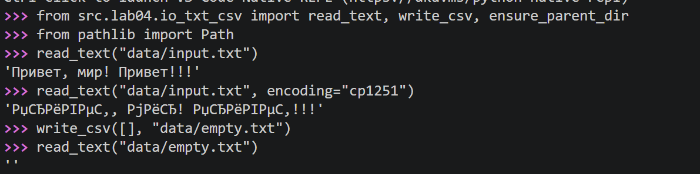
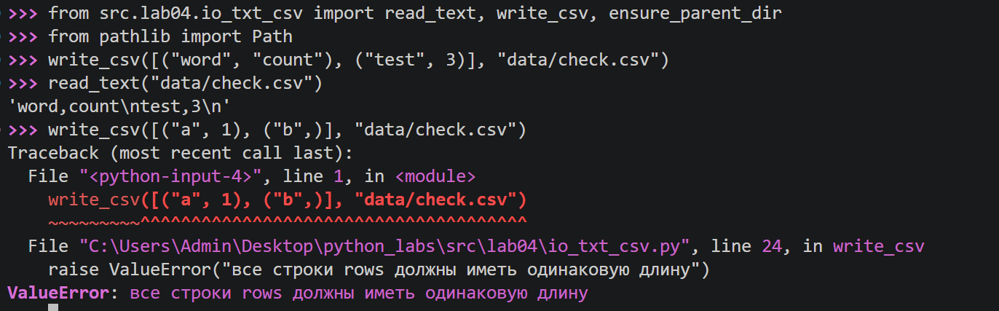
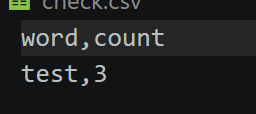
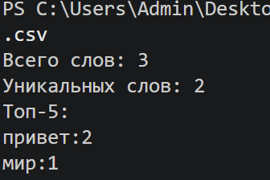
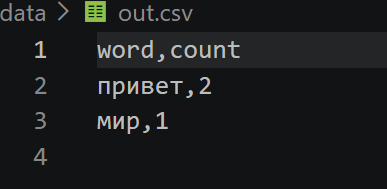
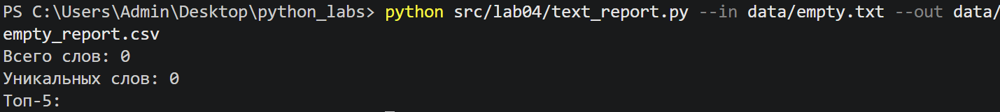
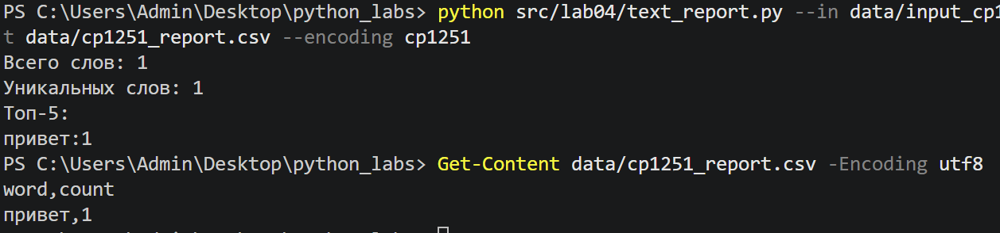
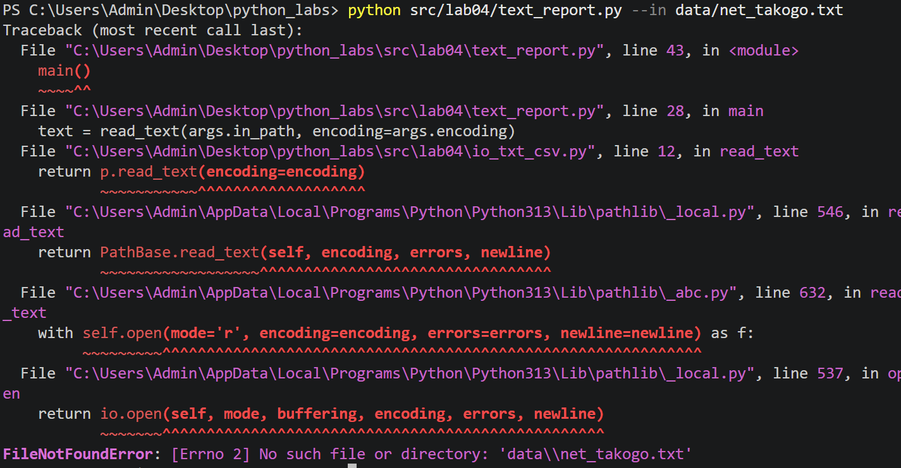

# ЛР4 — Файлы: TXT/CSV и отчёты по текстовой статистике

Что сделано:
- модуль `src/lab04/io_txt_csv.py` с функциями `read_text`, `write_csv`, `ensure_parent_dir`;
- скрипт `src/lab04/text_report.py`: читает текстовый файл, считает частоты слов, сохраняет отчёт в CSV и печатает краткую сводку;
- тестовые файлы в папке `data/`.

Все команды запускаются из корня репозитория (папка `python_labs`).

## Задание A — `src/lab04/io_txt_csv.py`

### `read_text(path, encoding="utf-8") -> str`

Читает текстовый файл целиком и возвращает его содержимое одной строкой. Кодировка по умолчанию UTF-8. Чтобы прочитать файл в другой кодировке, её передают явно: `read_text("data/input.txt", encoding="cp1251")`.

Ошибки функция не перехватывает, они «всплывают» наверх:
- файл не найден → `FileNotFoundError`;
- содержимое не соответствует кодировке → `UnicodeDecodeError`.

Проверка в консоли Python: обычное чтение, чтение в неверной кодировке и пустой файл.



*Рис. 1. Проверка `read_text`: обычное чтение, неверная кодировка, пустой файл.*

Во втором вызове файл в UTF-8 прочитан как cp1251: ошибки нет, но вместо слов получились «кракозябры». Это показывает, зачем кодировку нужно указывать явно. В третьем вызове пустой файл дал пустую строку.

### `write_csv(rows, path, header=None) -> None`

Создаёт или перезаписывает CSV-файл с разделителем `,` в кодировке UTF-8. Если передан `header`, он записывается первой строкой. Перед записью проверяется, что все строки `rows` имеют одинаковую длину, иначе `ValueError`.

Проверка в консоли Python: обычная запись (с чтением файла обратно) и строки разной длины.



*Рис. 2. Проверка `write_csv`: обычная запись и ошибка при строках разной длины.*

Содержимое созданного файла `data/check.csv`:



*Рис. 3. Файл `data/check.csv`, созданный функцией `write_csv`.*

### `ensure_parent_dir(path) -> None`

Создаёт родительские папки для указанного пути, если их ещё нет. Например, для `data/reports/report.csv` будет создана папка `data/reports`. Если папка уже существует, ничего не происходит. Функция используется в `text_report.py` перед записью отчёта.

### Краевые случаи

| Ситуация | Поведение |
|---|---|
| `read_text`: пустой файл | возвращается пустая строка |
| `read_text`: файл не найден | `FileNotFoundError` |
| `read_text`: кодировка не подходит | `UnicodeDecodeError` (или «кракозябры», если байты всё же удалось расшифровать) |
| `write_csv`: строки разной длины | `ValueError`, файл не создаётся |
| `write_csv`: пустой `rows`, `header=None` | создаётся пустой файл (0 строк) |
| `write_csv`: пустой `rows`, `header` задан | файл содержит только заголовок |

**Про большие файлы.** `read_text` читает файл целиком в память, это допускается заданием. В реальной работе с очень большими файлами лучше читать их построчно, чтобы не держать весь текст в памяти.

## Задание B — `src/lab04/text_report.py`

Скрипт выполняет по порядку:
1. читает входной файл;
2. нормализует текст и разбивает его на слова (`normalize`, `tokenize` из ЛР3);
3. считает частоты слов (`count_freq`);
4. сортирует пары `(слово, частота)`: по убыванию частоты, при равенстве по слову;
5. сохраняет отчёт в CSV с колонками `word,count` (родительская папка создаётся при необходимости);
6. печатает в консоль: всего слов, уникальных слов и топ-5 в формате `слово:кол-во`.

### Аргументы командной строки

| Аргумент | Что означает | По умолчанию |
|---|---|---|
| `--in` | входной текстовый файл | `data/input.txt` |
| `--out` | путь к CSV-отчёту | `data/report.csv` |
| `--encoding` | кодировка входного файла | `utf-8` |

### Запуск

Без аргументов (читает `data/input.txt`, пишет `data/report.csv`):

```
python src/lab04/text_report.py
```

С указанием входного и выходного файлов:

```
python src/lab04/text_report.py --in data/in.txt --out data/out.csv
```

С другой кодировкой входного файла:

```
python src/lab04/text_report.py --in data/input_cp1251.txt --out data/cp1251_report.csv --encoding cp1251
```

### Пример: базовый запуск

Входной файл `data/in.txt` содержит строку `Привет, мир! Привет!!!`.



*Рис. 4. Запуск `text_report.py` с аргументами `--in` и `--out`.*

Получившийся отчёт `data/out.csv`:



*Рис. 5. Файл `data/out.csv`: строки отсортированы по `count` по убыванию, затем по `word`.*

### Пустой входной файл

Политика: при пустом входе в `report.csv` записывается **только заголовок** `word,count`. В консоль выводятся нули (`Всего слов: 0`, `Уникальных слов: 0`), а список топа пустой.



*Рис. 6. Запуск на пустом файле `data/empty.txt` и содержимое отчёта (только заголовок).*

### Другая кодировка (cp1251)

Входной файл `data/input_cp1251.txt` записан в кодировке cp1251 и содержит слово «Привет». Чтобы прочитать его, кодировка передаётся через `--encoding cp1251`.



*Рис. 7. Чтение файла в cp1251 с параметром `--encoding cp1251`.*

Параметр `--encoding` относится только к **чтению** входного файла. Отчёт `write_csv` всегда записывает в UTF-8.

### Поведение при ошибках

Если входной файл не найден или его кодировка не подходит, исключение не перехватывается: программа завершается с трассировкой ошибки (`FileNotFoundError` или `UnicodeDecodeError`). Отчёт при этом не создаётся и существующий не изменяется.



*Рис. 8. Запуск с несуществующим файлом: `FileNotFoundError`.*

## Про кодировки

- Текстовые файлы читаются и записываются в **UTF-8**, кодировка всегда указывается явно, а не берётся «по умолчанию» из системы.
- Если файл записан в другой кодировке, её нужно передать (`--encoding cp1251` для скрипта или `encoding="cp1251"` для `read_text`).
- Если указать не ту кодировку, возможны два исхода: ошибка `UnicodeDecodeError` или «кракозябры» вместо слов.

## Тестовые файлы в `data/`

| Файл | Содержимое |
|---|---|
| `input.txt` | `Привет, мир! Привет!!!` (UTF-8), вход по умолчанию |
| `in.txt` | то же, для примера с `--in` |
| `empty.txt` | пустой файл |
| `input_cp1251.txt` | слово «Привет» в кодировке cp1251 |