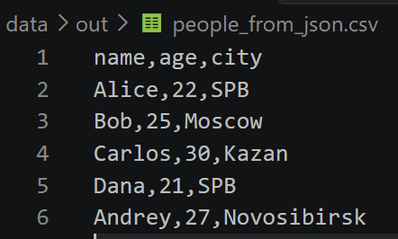
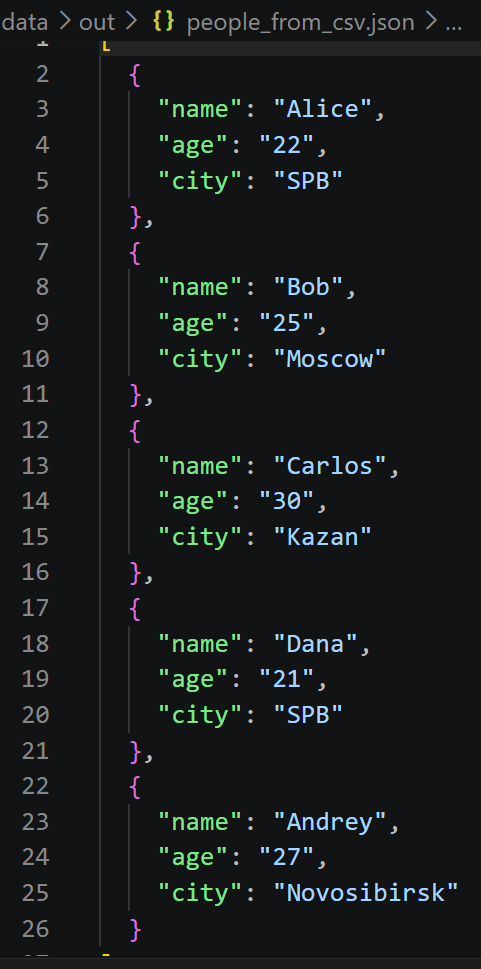
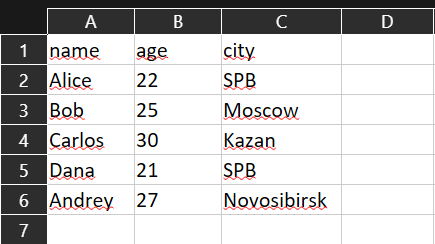
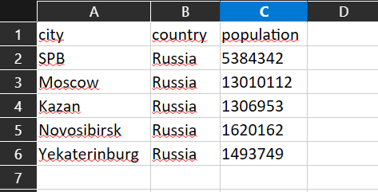
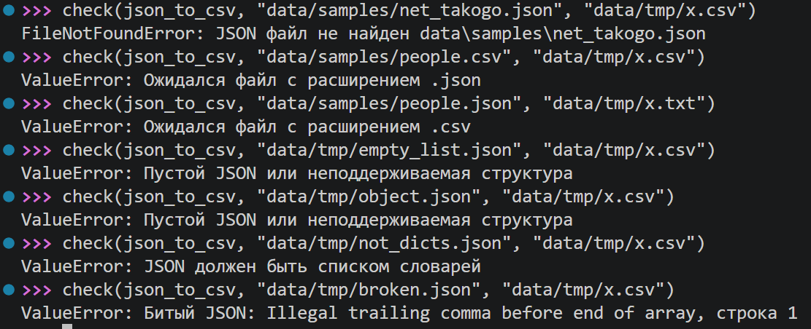
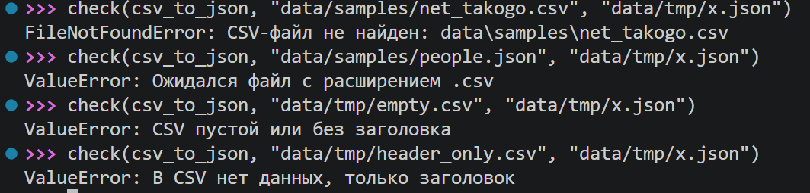

# ЛР5 — JSON и конвертации (JSON↔CSV, CSV→XLSX)

Что сделано:
- `src/lab05/json_csv.py`: функции `json_to_csv(json_path, csv_path)` и `csv_to_json(csv_path, json_path)`;
- `src/lab05/csv_xlsx.py`: функция `csv_to_xlsx(csv_path, xlsx_path)` (библиотека `openpyxl`);
- `src/lib/io_helpers.py`: функция `ensure_parent_dir(path)`, создаёт папку для результата; используется во всех трёх функциях;
- `data/samples/`: входные файлы `people.json`, `people.csv`, `cities.csv`;
- `data/out/`: результаты конвертаций;
- `requirements.txt`: одна зависимость, `openpyxl`.

Функции ничего не печатают в консоль: они только работают с файлами, а при проблемах выбрасывают исключения.

## Установка и запуск

Все команды запускаются **из корня репозитория** (папка `python_labs`).

Установка зависимости:

```
python -m pip install -r requirements.txt
```

Запуск демонстрации обоих модулей:

```
python -m src.lab05.json_csv
python -m src.lab05.csv_xlsx
```

Каждая команда по завершении печатает `Готово: результаты в data/out/`.

## Сценарии демонстрации

### 1. JSON → CSV

Входной файл `data/samples/people.json` содержит 5 объектов с полями `name`, `age`, `city`. Результат `data/out/people_from_json.csv`:



*Рис. 1. Результат JSON → CSV: заголовок `name,age,city` и 5 строк данных.*


### 2. CSV → JSON

Входной файл `data/samples/people.csv` содержит заголовок и 5 строк. Результат `data/out/people_from_csv.json`:



*Рис. 2. Результат CSV → JSON: 5 объектов, значения `age` стали строками.*

```python
import csv
import json
from pathlib import Path
from src.lib.io_helpers import ensure_parent_dir

def json_to_csv(json_path: str | Path, csv_path: str | Path) -> None:
    """Преобразовывает JSON в CSV.

    Кодировка UTF-8. Отсутствующие поля заполняются пустой строкой.
    ValueError: неверное расширение файла; битый JSON; пустой JSON; в списке есть НЕ словарь.
    FileNotFoundError: JSON-файл не найден.
    """
    json_p = Path(json_path)
    csv_p = Path(csv_path)

    if not json_p.exists():
        raise FileNotFoundError(f'JSON файл не найден {json_p}')
    if json_p.suffix.lower() != ".json":
        raise ValueError("Ожидался файл с расширением .json")
    if csv_p.suffix.lower() != ".csv":
        raise ValueError("Ожидался файл с расширением .csv")

    with json_p.open(encoding="utf-8") as f:
        try:
            data = json.load(f)
        except json.JSONDecodeError as e:
            raise ValueError(f"Битый JSON: {e.msg}, строка {e.lineno}") from e

    if not isinstance(data, list) or not data:
        raise ValueError("Пустой JSON или неподдерживаемая структура")
    for item in data:
        if not isinstance(item, dict):
            raise ValueError("JSON должен быть списком словарей")

    fieldnames = []
    for item in data:
        for key in item:
            if key not in fieldnames:
                fieldnames.append(key)
    
    ensure_parent_dir(csv_p)
    with csv_p.open("w", encoding="utf-8", newline="") as f:
        writer = csv.DictWriter(f, fieldnames=fieldnames, restval="")
        writer.writeheader()
        writer.writerows(data)


def csv_to_json(csv_path: str | Path, json_path: str | Path) -> None:
    """Преобразовывает CSV в JSON.
    
    ValueError: неверное расширение файла; CSV пустой или без заголовка; в CSV только заголовок.
    FileNotFoundError: CSV-файл не найден.
    """
    csv_p = Path(csv_path)
    json_p = Path(json_path)

    if not csv_p.exists():
        raise FileNotFoundError(f"CSV-файл не найден: {csv_p}")
    if csv_p.suffix.lower() != ".csv":
        raise ValueError("Ожидался файл с расширением .csv")
    if json_p.suffix.lower() != ".json":
        raise ValueError("Ожидался файл с расширением .json")

    with csv_p.open(encoding="utf-8", newline="") as f:
        reader = csv.DictReader(f)
        if not reader.fieldnames:
            raise ValueError("CSV пустой или без заголовка")
        rows = list(reader)

    if not rows:
        raise ValueError("В CSV нет данных, только заголовок")

    ensure_parent_dir(json_p)
    with json_p.open("w", encoding="utf-8") as f:
        json.dump(rows, f, ensure_ascii=False, indent=2)


if __name__ == "__main__":
    json_to_csv("data/samples/people.json", "data/out/people_from_json.csv")
    csv_to_json("data/samples/people.csv", "data/out/people_from_csv.json")
    print("Готово: результаты в data/out/")

```

### 3. CSV → XLSX

Из `data/samples/people.csv` получается `data/out/people.xlsx`, из `data/samples/cities.csv` получается `data/out/cities.xlsx`. Заголовок записан первой строкой листа `Sheet1`, ширина колонок подобрана по самому длинному значению (не меньше 8 символов).



*Рис. 3. Таблица `data/out/people.xlsx`*



*Рис. 4. Таблица `data/out/cities.xlsx`*

```python
import csv
from pathlib import Path

from openpyxl import Workbook
from openpyxl.utils import get_column_letter
from src.lib.io_helpers import ensure_parent_dir


def csv_to_xlsx(csv_path: str | Path, xlsx_path: str | Path) -> None:
    """Конвертирует CSV в XLSX.
    ValueError: неверное расширение файла; CSV пустой или в нём только заголовок.
    FileNotFoundError: CSV не найден.
    """
    csv_p = Path(csv_path)
    xlsx_p = Path(xlsx_path)
    
    if not csv_p.exists():
        raise FileNotFoundError(f"CSV не найден: {csv_p}")
    if csv_p.suffix.lower() != ".csv":
        raise ValueError("Ожидался файл с расширением .csv")
    if xlsx_p.suffix.lower() != ".xlsx":
        raise ValueError("Ожидался файл с расширением .xlsx")

    with csv_p.open(encoding="utf-8", newline="") as f:
        rows = list(csv.reader(f))

    if len(rows) < 2:
        raise ValueError("CSV пустой или содержит только заголовок")

    wb = Workbook()
    ws = wb.active
    ws.title = "Sheet1"

    for row in rows:
        ws.append(row)

    column_count = max(len(row) for row in rows)
    for col_index in range(column_count):
        longest = 0
        for row in rows:
            if col_index < len(row):
                longest = max(longest, len(row[col_index]))
        letter = get_column_letter(col_index + 1)
        ws.column_dimensions[letter].width = max(8, longest)

    ensure_parent_dir(xlsx_p)
    wb.save(xlsx_p)


if __name__ == "__main__":
    csv_to_xlsx("data/samples/people.csv", "data/out/people.xlsx")
    csv_to_xlsx("data/samples/cities.csv", "data/out/cities.xlsx")
    print("Готово: результаты в data/out/")
```

## Проверка ошибок (запуск в консоли)

Проверки запускаются вручную в консоли Python, из корня репозитория.

### Подготовка

Открыть консоль Python:

```
python -q
```

Создать временные «плохие» файлы в папке `data/tmp` (команды вводятся по одной):

```python
from pathlib import Path
d = Path("data/tmp")
d.mkdir(exist_ok=True)
(d / "empty_list.json").write_text("[]", encoding="utf-8")
(d / "object.json").write_text('{"a": 1}', encoding="utf-8")
(d / "not_dicts.json").write_text("[1, 2, 3]", encoding="utf-8")
(d / "broken.json").write_text('[{"a": 1},]', encoding="utf-8")
(d / "empty.csv").write_text("", encoding="utf-8")
(d / "header_only.csv").write_text("a,b\n", encoding="utf-8")
```

Вспомогательная функция `check`: вызывает функцию и печатает, какая ошибка получилась:

```python
def check(func, *args):
    try:
        func(*args)
        print("OK, ошибки нет")
    except Exception as e:
        print(type(e).__name__ + ":", e)
```

Подключить функции:

```python
from src.lab05.json_csv import json_to_csv, csv_to_json
from src.lab05.csv_xlsx import csv_to_xlsx
```

### `json_to_csv`



*Рис. 5. Проверка ошибок `json_to_csv` в консоли Python.*

### `csv_to_json`



*Рис. 6. Проверка ошибок `csv_to_json` в консоли Python.*
