# Лабораторная работа №6
Лелькова Юлия

В ЛР6 я обернула функции из ЛР3, ЛР4 и ЛР5 в консольные утилиты на `argparse`:
- `cli_text.py` — подкоманды `cat` (вывод файла) и `stats` (частоты слов);
- `cli_convert.py` — подкоманды `json2csv`, `csv2xlsx`, `csv2json` (конвертация с помощью функций из ЛР5).

## cli_text.py

### Подкоманда cat
Выводит файл построчно, флаг `-n` добавляет номера строк.

```python
def cat_command(input_path: str, numbered: bool = False) -> None:
    path = Path(input_path)
    if not path.is_file():
        raise FileNotFoundError("Файл не найден")

    with open(path, "r", encoding="utf-8") as f:
        for num, line in enumerate(f, start=1):
            line = line.rstrip("\n")
            if numbered:
                print(f"{num}: {line}")
            else:
                print(line)
```

Запуск с нумерацией строк:
```
python -m src.lab06.cli_text cat --input data/samples/people.csv -n
```
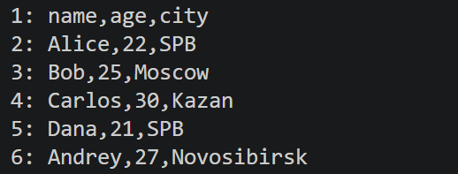


### Подкоманда stats
Считает общее число слов, число уникальных слов и выводит топ самых частых слов (по умолчанию 5).

```python
def stats_command(input_path: str, top: int = 5) -> None:
    path = Path(input_path)
    if not path.is_file():
        raise FileNotFoundError("Файл не найден")

    text = read_text(input_path)
    tokens = tokenize(normalize(text))
    freq = count_freq(tokens)

    print(f"Всего слов: {len(tokens)}")
    print(f"Уникальных слов: {len(freq)}")
    print(f"Топ-{top}:")
    for word, count in top_n(freq, top):
        print(f"{word}: {count}")
```

Запуск с топом по умолчанию:
```
python -m src.lab06.cli_text stats --input data/lab04/input.txt
```
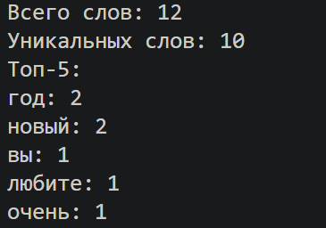

Запуск с заданным размером топа:
```
python -m src.lab06.cli_text stats --input data/lab04/input.txt --top 3
```
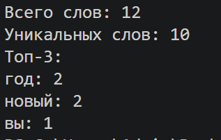

### Функция main и справка

```python
def main() -> None:
    parser = argparse.ArgumentParser(description="CLI-утилиты для работы с текстом")
    subparsers = parser.add_subparsers(dest="command", required=True)

    cat_parser = subparsers.add_parser("cat", help="Вывести файл построчно")
    cat_parser.add_argument("--input", required=True, help="Путь к текстовому файлу")
    cat_parser.add_argument("-n", action="store_true", help="Нумеровать строки")

    stats_parser = subparsers.add_parser("stats", help="Частоты слов в тексте")
    stats_parser.add_argument("--input", required=True, help="Путь к текстовому файлу")
    stats_parser.add_argument("--top", type=int, default=5, help="Размер топа (по умолчанию 5)")

    args = parser.parse_args()

    if args.command == "stats" and args.top < 1:
        parser.error("--top должен быть больше 0")

    try:
        if args.command == "cat":
            cat_command(args.input, args.n)
        elif args.command == "stats":
            stats_command(args.input, args.top)
    except FileNotFoundError:
        parser.error(f"Файл не найден: {args.input}")
    except UnicodeDecodeError:
        parser.error(f"Файл {args.input} не в кодировке UTF-8")


if __name__ == "__main__":
    main()
```

Общая справка:
```
python -m src.lab06.cli_text --help
```
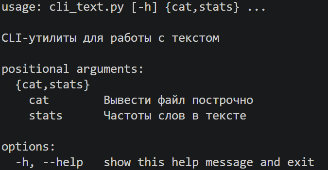

Справка по `cat`:
```
python -m src.lab06.cli_text cat --help
```
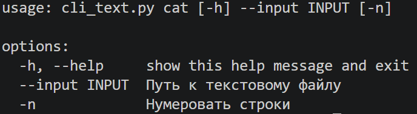

Справка по `stats`:
```
python -m src.lab06.cli_text stats --help
```
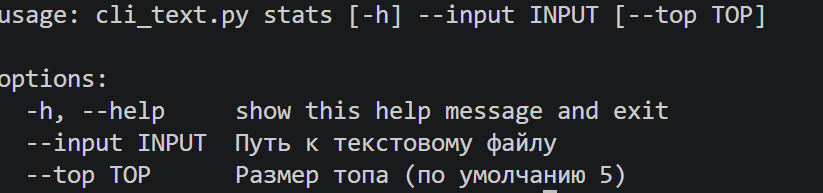

## cli_convert.py

Утилита конвертирует данные между форматами JSON, CSV и XLSX. Сама конвертация выполняется функциями из ЛР5, а пути из терминала перед вызовом превращаются в объекты `Path`.

```python
def main() -> None:
    parser = argparse.ArgumentParser(
        description="Конвертация данных между форматами JSON, CSV и XLSX"
    )
    subparsers = parser.add_subparsers(dest="command", required=True)

    # json2csv
    json2csv_parser = subparsers.add_parser("json2csv", help="JSON -> CSV")
    json2csv_parser.add_argument("--in", dest="input", required=True, help="Входной файл JSON")
    json2csv_parser.add_argument("--out", dest="output", required=True, help="Выходной файл CSV")

    # csv2xlsx
    csv2xlsx_parser = subparsers.add_parser("csv2xlsx", help="CSV -> XLSX")
    csv2xlsx_parser.add_argument("--in", dest="input", required=True, help="Входной файл CSV")
    csv2xlsx_parser.add_argument("--out", dest="output", required=True, help="Выходной файл XLSX")

    # csv2json
    csv2json_parser = subparsers.add_parser("csv2json", help="CSV -> JSON")
    csv2json_parser.add_argument("--in", dest="input", required=True, help="Входной файл CSV")
    csv2json_parser.add_argument("--out", dest="output", required=True, help="Выходной файл JSON")

    args = parser.parse_args()

    try:
        if args.command == "json2csv":
            json_to_csv(Path(args.input), Path(args.output))
        elif args.command == "csv2xlsx":
            csv_to_xlsx(Path(args.input), Path(args.output))
        elif args.command == "csv2json":
            csv_to_json(Path(args.input), Path(args.output))

        print(f"Готово: {args.input} -> {args.output}")

    except FileNotFoundError:
        parser.error(f"Файл не найден: {args.input}")
    except UnicodeDecodeError:
        parser.error(f"Файл {args.input} не в кодировке UTF-8")
    except ValueError as error:
        parser.error(f"Некорректные данные: {error}")


if __name__ == "__main__":
    main()
```

### json to csv
Конвертирует JSON в CSV.
```
python -m src.lab06.cli_convert json2csv --in data/samples/people.json --out data/out/people.csv
```
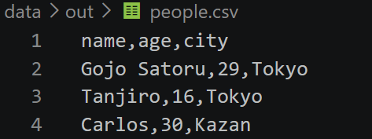

### csv to json
Конвертирует CSV в JSON.
```
python -m src.lab06.cli_convert csv2json --in data/samples/people.csv --out data/out/people.json
```
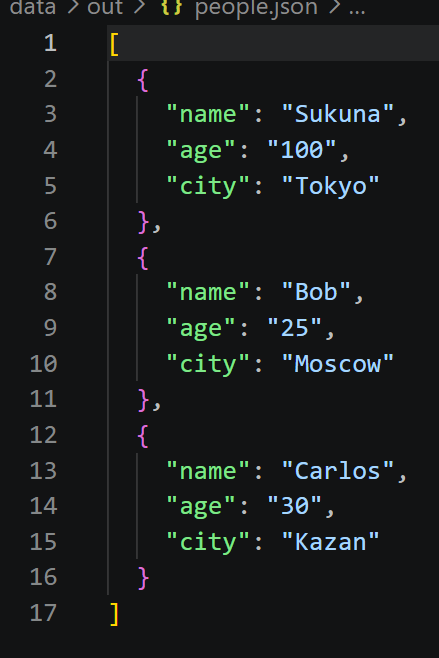

### csv to xlsx
Конвертирует CSV в XLSX.
```
python -m src.lab06.cli_convert csv2xlsx --in data/samples/people.csv --out data/out/people.xlsx
```
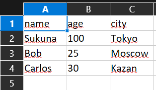

### Справка
Общая справка по всем подкомандам:
```
python -m src.lab06.cli_convert --help
```
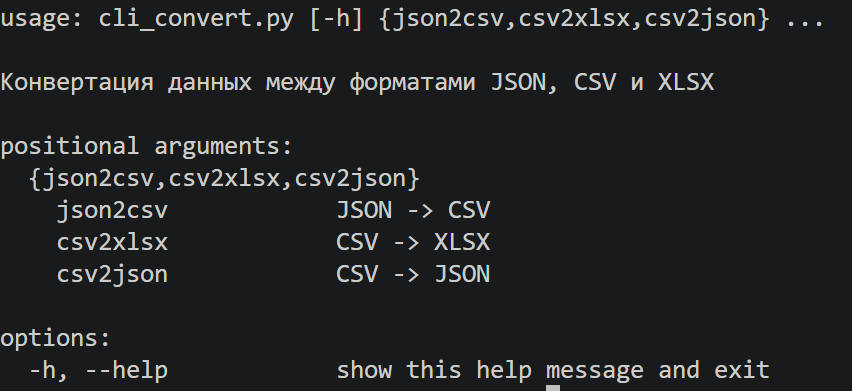

Справка по `json to csv`:
```
python -m src.lab06.cli_convert json2csv --help
```
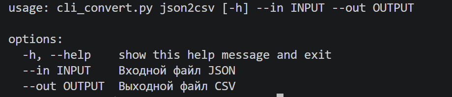

Справка по `csv to json`:
```
python -m src.lab06.cli_convert csv2json --help
```
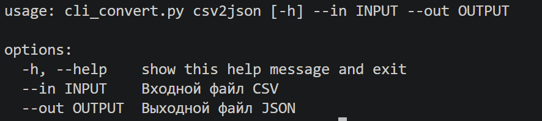

Справка по `csv to xlsx`:
```
python -m src.lab06.cli_convert csv2xlsx --help
```
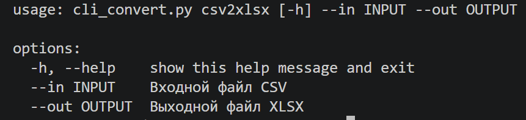

## Обработка ошибок

Файл не найден:
```
python -m src.lab06.cli_text cat --input data/samples/net.txt
```
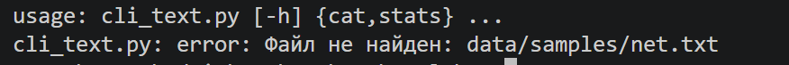

Неверное значение `--top`:
```
python -m src.lab06.cli_text stats --input data/lab04/input.txt --top 0
```
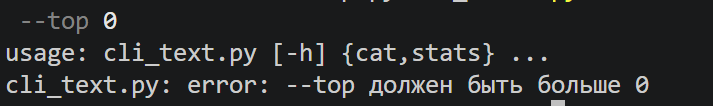