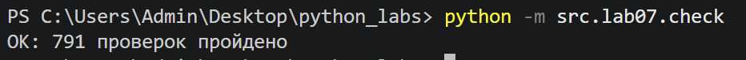
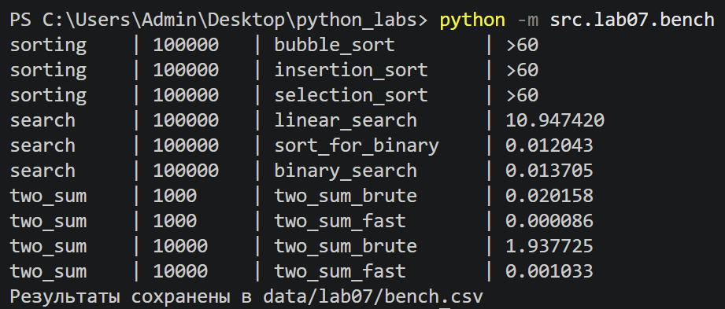

# Лабораторная работа №7. Поиск, сортировка и измерение времени

**Лельковой Юлии, БИВТ-26-6-1**


Запуск из корня репозитория:

```
python -m src.lab07.check
python -m src.lab07.bench
```


## 1. Поиск (`search.py`)

### `linear_search`

Идёт по списку слева направо и возвращает индекс первого элемента, равного `x`. Если список закончился, возвращает `-1`. Порядок элементов не важен.

```python
def linear_search(nums, x):
    """Индекс первого вхождения x или -1.
    """
    for i in range(len(nums)):
        if nums[i] == x:
            return i
    return -1
```

### `binary_search`

Требует отсортированный список. Сравнивает `x` с серединным элементом и отбрасывает ту половину, где `x` быть не может. Пока `lo <= hi`, область поиска не пуста; когда границы разошлись, элемента нет. На неотсортированном списке результат не определён.

```python
def binary_search(sorted_nums, x):
    """Индекс x в отсортированном по возрастанию списке или -1.
    На неотсортированном списке результат не определён.
    """
    lo = 0
    hi = len(sorted_nums) - 1
    while lo <= hi:
        mid = (lo + hi) // 2
        if sorted_nums[mid] == x:
            return mid
        if sorted_nums[mid] < x:
            lo = mid + 1  
        else:
            hi = mid - 1  
    return -1
```

### `two_sum_brute`

Перебирает все пары индексов `(i, j)` с `i < j` и возвращает первую пару с нужной суммой, а если такой нет, то `None`.

```python
def two_sum_brute(nums, target):
    """Пара индексов (i, j), i < j, nums[i] + nums[j] == target, или None.
    """
    n = len(nums)
    for i in range(n):
        for j in range(i + 1, n):
            if nums[i] + nums[j] == target:
                return (i, j)
    return None
```

### `two_sum_fast`

Идёт по списку один раз и хранит в словаре `seen` уже просмотренные значения с их индексами. Для каждого числа проверяет, есть ли в словаре `target − число`. Проверка `in` у словаря не перебирает ключи, поэтому проход линейный.

```python
def two_sum_fast(nums, target):
    """То же, что two_sum_brute, но за один проход со словарём.
    """
    seen = {}
    for j in range(len(nums)):
        need = target - nums[j]
        if need in seen:
            return (seen[need], j)  
        seen[nums[j]] = j
    return None
```

## 2. Сортировки (`sorting.py`)


### `bubble_sort`

Проходит по списку и меняет местами соседей, стоящих не по порядку; после каждого прохода самый большой из оставшихся оказывается в конце. Если за проход не было ни одного обмена, цикл прерывается: список уже отсортирован.

```python
def bubble_sort(nums):
    """Новый список, отсортированный по возрастанию. Исходный не меняется.
    """
    a = list(nums)  
    n = len(a)
    for end in range(n - 1, 0, -1):
        swapped = False
        for i in range(end):
            if a[i] > a[i + 1]:
                a[i], a[i + 1] = a[i + 1], a[i]
                swapped = True
        if not swapped:  
            break
    return a
```

### `insertion_sort`

Берёт очередной элемент и сдвигает его влево по отсортированной части: большие элементы смещаются вправо, а сам элемент встаёт в освободившуюся ячейку.

```python
def insertion_sort(nums):
    """Тот же контракт, что у bubble_sort."""
    a = list(nums)
    for i in range(1, len(a)):
        item = a[i]
        j = i - 1
        while j >= 0 and a[j] > item:
            a[j + 1] = a[j]
            j -= 1
        a[j + 1] = item
    return a
```

### `selection_sort`

На каждом шаге находит минимум в неотсортированной части обычным циклом (без `min`) и обменом ставит его на текущую позицию.

```python
def selection_sort(nums):
    """Тот же контракт, что у bubble_sort."""
    a = list(nums)
    n = len(a)
    for i in range(n - 1):
        m = i
        for j in range(i + 1, n):
            if a[j] < a[m]:
                m = j
        a[i], a[m] = a[m], a[i]
    return a
```

## 3. Проверка против эталона (`check.py`)

### `check_sorting`

На 100 случайных списках (длина 0–50, значения −100…100, с повторами) сравнивает `fn(nums)` с `sorted(nums)` и проверяет, что исходный список не изменился.

```python
def check_sorting(fn, trials=100) -> int:
    """Сравнивает fn(nums) с sorted(nums) и проверяет, что исходный список цел.
    Возвращает число проведённых проверок.
    """
    for _ in range(trials):
        n = random.randint(0, 50)
        nums = [random.randint(-100, 100) for _ in range(n)]
        original = list(nums)
        result = fn(nums)
        assert result == sorted(nums), f"{fn.__name__} ошиблась на {original}: {result}"
        assert nums == original, f"{fn.__name__} изменила исходный список: было {original}, стало {nums}"
    return trials
```

### `check_search`

На 100 случайных списках ищет число вне диапазона, первый, последний и случайный элемент. Линейный поиск сверяется с `list.index` (`ValueError` превращается в `-1`), а бинарный проверяется на отсортированной копии: при повторах допустим любой индекс, лишь бы по нему лежал `x`.

```python
def check_search() -> int:
    """Сравнивает linear_search с list.index, а binary_search проверяет по содержимому.
    Возвращает число проведённых проверок.
    """
    checks = 0
    for _ in range(100):
        n = random.randint(0, 50)
        nums = [random.randint(-100, 100) for _ in range(n)]
        sorted_nums = sorted(nums)
        targets = [101]
        if nums:
            targets += [nums[0], nums[-1], random.choice(nums)]

        for x in targets:
            try:
                expected = nums.index(x)
            except ValueError:
                expected = -1
            got = linear_search(nums, x)
            assert got == expected, f"linear_search({nums}, {x}) = {got}, ожидали {expected}"

            got = binary_search(sorted_nums, x)
            if x in sorted_nums:
                assert 0 <= got < len(sorted_nums), f"binary_search({sorted_nums}, {x}) вернул {got}"
                assert sorted_nums[got] == x, f"binary_search({sorted_nums}, {x}) = {got}, а там не x"
            else:
                assert got == -1, f"binary_search({sorted_nums}, {x}) = {got}, ожидали -1"
            checks += 1
    return checks
```

### `check_two_sum`

Полным перебором собирает список `expected` со всеми подходящими парами. Если пары есть, оба решения обязаны вернуть одну из них (какую именно, не важно), если нет, то `None`.

```python
def check_two_sum(trials=100) -> int:
    """Оба two_sum должны вернуть одну из подходящих пар, а если пар нет, то None.
    Возвращает число проведённых проверок.
    """
    for _ in range(trials):
        n = random.randint(0, 30)
        nums = [random.randint(-50, 50) for _ in range(n)]
        target = random.randint(-100, 100)
        expected = []
        for i in range(n):
            for j in range(i + 1, n):
                if nums[i] + nums[j] == target:
                    expected.append((i, j))

        brute = two_sum_brute(nums, target)
        fast = two_sum_fast(nums, target)
        info = f"nums={nums}, target={target}, brute={brute}, fast={fast}"
        if expected:
            assert brute in expected, "two_sum_brute вернул неверную пару: " + info
            assert fast in expected, "two_sum_fast вернул неверную пару: " + info
        else:
            assert brute is None, "two_sum_brute нашёл пару, которой нет: " + info
            assert fast is None, "two_sum_fast нашёл пару, которой нет: " + info
    return trials

```

### Запуск и результат

```python
if __name__ == "__main__":
    random.seed(42)
    total = 0
    for fn in (bubble_sort, insertion_sort, selection_sort):
        total += check_sorting(fn)
    total += check_search()
    total += check_two_sum()
    print(f"OK: {total} проверок пройдено")
```

```
$ python -m src.lab07.check
OK: 791 проверок пройдено
```



## 4. Бенчмарк (`bench.py`)

### `bench_sorts`

Замеряет `sorted` и три свои сортировки на n = 1 000, 10 000 и 100 000. Перед замером на n = 1 000 проверяет, что ответ верный. Возвращает список кортежей `(task, n, impl, seconds)`.

```python
def bench_sorts() -> list[tuple[str, int, str, str]]:
    """Замеряет sorted и три свои сортировки, возвращает список кортежей."""
    random.seed(42)
    rows = []
    sizes = [1_000, 10_000, 100_000]
    funcs = [
        ("bubble_sort", bubble_sort),
        ("insertion_sort", insertion_sort),
        ("selection_sort", selection_sort),
    ]
    for n in sizes:
        data = [random.randint(-1_000_000, 1_000_000) for _ in range(n)]
        time_s = timeit.timeit(lambda: sorted(data), number=10) / 10
        rows.append(("sorting", n, "sorted", f"{time_s:.6f}"))

        for name, fc in funcs:
            if n <= 10_000:
                if n == 1_000:  
                    assert fc(data) == sorted(data), f"{name} ошиблась на n={n}"
                time_s = timeit.timeit(lambda: fc(data), number=1)
                rows.append(("sorting", n, name, f"{time_s:.6f}"))
            else:
                rows.append(("sorting", n, name, ">60"))
    return rows
```

### `bench_search`

Замеряет линейный и бинарный поиск (10 000 запросов к списку из 100 000) и два решения Two Sum на n = 1 000 и 10 000.

```python
def bench_search() -> list[tuple[str, int, str, str]]:
    """Замеряет поиск (линейный и бинарный) и два решения Two Sum, возвращает список кортежей."""
    random.seed(42)
    rows = []
    n = 100_000
    data = [random.randint(-1_000_000, 1_000_000) for _ in range(n)]
    targets = [random.choice(data) for _ in range(10_000)]  

    time_ls = timeit.timeit(lambda: [linear_search(data, t) for t in targets], number=1)
    rows.append(("search", n, "linear_search", f"{time_ls:.6f}"))

    time_sort = timeit.timeit(lambda: sorted(data), number=10) / 10
    rows.append(("search", n, "sort_for_binary", f"{time_sort:.6f}"))

    sorted_data = sorted(data)
    time_bs = timeit.timeit(lambda: [binary_search(sorted_data, t) for t in targets], number=5) / 5
    rows.append(("search", n, "binary_search", f"{time_bs:.6f}"))

    for size in [1_000, 10_000]:
        data_ts = [random.randint(0, 10**9) for _ in range(size)]
        target = data_ts[-2] + data_ts[-1]
        assert two_sum_brute(data_ts, target) is not None
        assert two_sum_fast(data_ts, target) is not None

        time_b = timeit.timeit(lambda: two_sum_brute(data_ts, target), number=1)
        rows.append(("two_sum", size, "two_sum_brute", f"{time_b:.6f}"))
        time_f = timeit.timeit(lambda: two_sum_fast(data_ts, target), number=100) / 100
        rows.append(("two_sum", size, "two_sum_fast", f"{time_f:.6f}"))
    return rows
```

### `main`

Объединяет результаты, сохраняет их в `data/lab07/bench.csv` и печатает таблицу в консоль.

```python
def main():
    """Собирает все замеры, сохраняет в CSV и печатает таблицу в консоль."""
    header = ("task", "n", "impl", "seconds")
    rows = []
    rows.extend(bench_sorts())
    rows.extend(bench_search())

    os.makedirs(os.path.dirname(CSV_PATH), exist_ok=True)
    write_csv(rows, CSV_PATH, header)

    print("Результаты бенчмарка:")
    print(f"{'Task':<10} | {'N':<8} | {'Impl':<18} | {'Seconds':<12}")
    print("-" * 56)
    for task, n, impl, sec in rows:
        print(f"{task:<10} | {n:<8} | {impl:<18} | {sec:<12}")
    print(f"Результаты сохранены в {CSV_PATH}")
```

### Результаты

Вывод в консоль:



Те же данные из `data/lab07/bench.csv`:

| task | n | impl | seconds |
|---|---:|---|---:|
| sorting | 1000 | sorted | 0.000058 |
| sorting | 1000 | bubble_sort | 0.023452 |
| sorting | 1000 | insertion_sort | 0.011016 |
| sorting | 1000 | selection_sort | 0.010718 |
| sorting | 10000 | sorted | 0.000943 |
| sorting | 10000 | bubble_sort | 2.773482 |
| sorting | 10000 | insertion_sort | 1.162041 |
| sorting | 10000 | selection_sort | 1.083761 |
| sorting | 100000 | sorted | 0.012119 |
| sorting | 100000 | bubble_sort | >60 |
| sorting | 100000 | insertion_sort | >60 |
| sorting | 100000 | selection_sort | >60 |
| search | 100000 | linear_search | 10.965099 |
| search | 100000 | sort_for_binary | 0.011821 |
| search | 100000 | binary_search | 0.014095 |
| two_sum | 1000 | two_sum_brute | 0.019763 |
| two_sum | 1000 | two_sum_fast | 0.000084 |
| two_sum | 10000 | two_sum_brute | 1.944602 |
| two_sum | 10000 | two_sum_fast | 0.001013 |


## Выводы

### Пузырёк и `sorted`

Квадратичные сортировки (пузырёк, вставки, выбор) имеют сложность O(n^2): при росте n в 10 раз время увеличивается примерно в 100 раз. На практике при переходе от 1 000 к 10 000 элементов время выросло в 105–112 раз.Встроенная sorted работает за O(n log n): при росте n в 10 раз замедление составило всего 12,9 (и 17,5 на 100 000 элементов). Уже на 10 000 элементов пузырёк медленнее sorted более чем в 3 000 раз, а на 100 000 он бы работал около 7 минут (в таблице отмечено как >60).

### Бинарный поиск и сортировка

Бинарный поиск работает за O(log n), но требует предварительно отсортированного списка (O(n log n)).На массиве из 100 000 элементов один линейный поиск занимает 1,15 мс, бинарный — 1,5 мкс, а сама сортировка — 14 мс. Из этого следует:Для 1–12 запросов выгоднее обычный линейный перебор (сортировка не успеет окупиться).При большом числе запросов связка «сортировка + бинарный поиск» кратно выигрывает: на 10 000 запросах она отработала за 0,029 с против 11,5 с у линейного поиска (быстрее в 393 раза).Похожий выигрыш даёт замена перебора на хэш-таблицу (словарь) в задаче Two Sum: на n = 10,000 время сократилось с 2,29 с (O(n^2)) до 0,7 мс (O(n)).

### Что показал `check.py`

Проведена 791 проверка. С помощью проверки обнаружила ошибку с неверным именем переменной. В `selection_sort` была опечатка: в условии `if a[j] < a[m]` вместо `m = j` записано `i = j`. `check_sorting` сравнил результат с
`sorted(nums)` и упал с `AssertionError: selection_sort ошиблась на [...]: [...]`,
показав исходный список и неверный ответ. Исправление: `m = j`.

